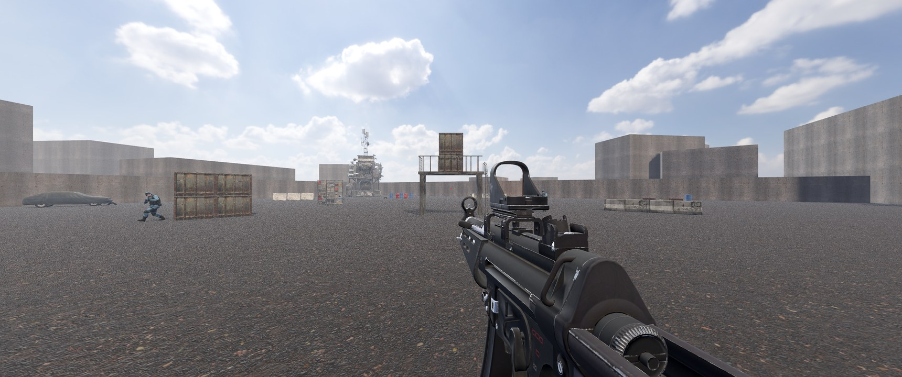
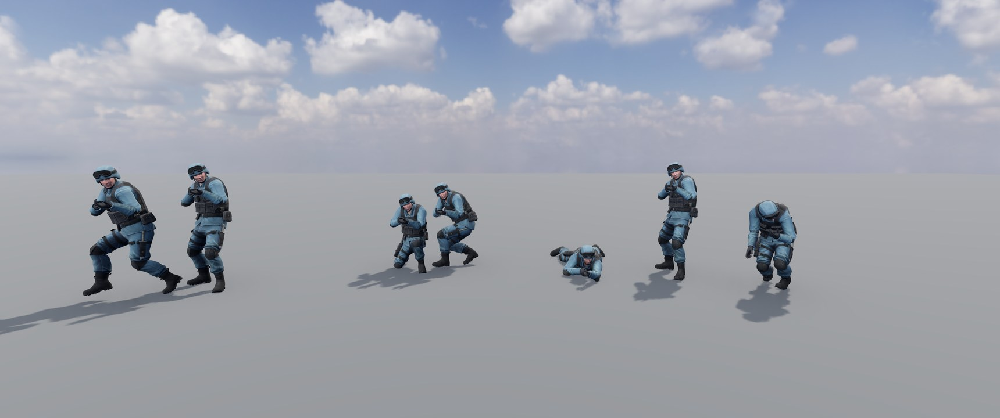
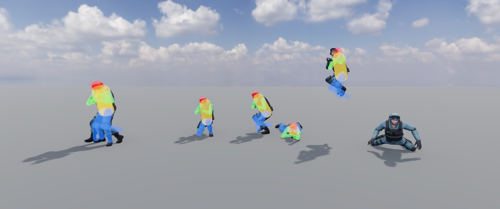
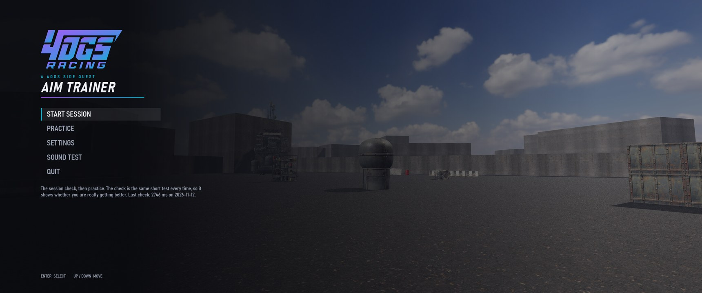
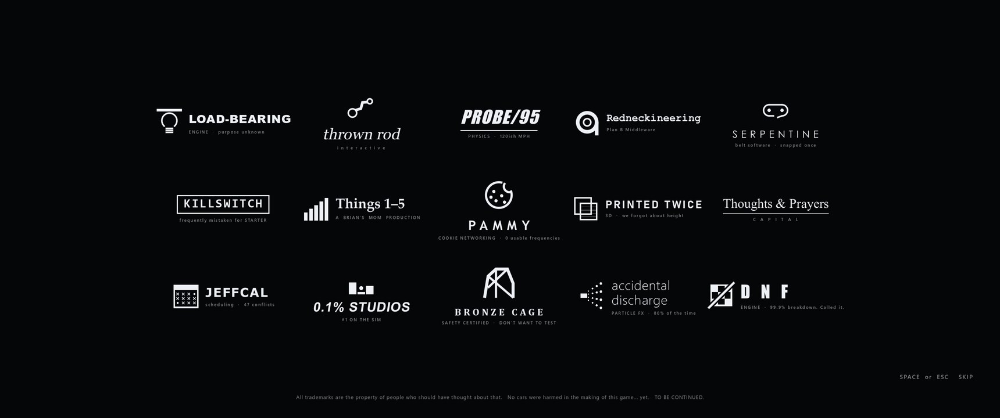

<p align="center">
  
</p>

<h1 align="center">4OGS Aim Trainer</h1>

<p align="center"><b>Nobody asked for this. Including us.</b></p>

<p align="center">
  <a href="https://github.com/forcetrainer/4ogs-aimtrainer/releases"></a>
  
  
  
  
  <a href="LICENSE"></a>
  
  
</p>

<p align="center">
  
  
  
  
  
  
  
  
</p>

---

## What is this?

[4OGS Racing](https://www.4ogs.racing) is four friends who race a $500 1995 Ford
Probe in the 24 Hours of Lemons. Very racy. Questionably pacey.

This is not that. This is an aim trainer for first-person shooters.

To be clear about how it came to exist:

- We did not need an aim trainer.
- We are not sure we wanted one.
- It has nothing to do with racing.
- We built it anyway.

It is a **4OGS side quest**: one of the things we do instead of fixing the car.

## Is it any good?

It's not half bad. It kind of does the job that other aim trainers may or may
not do.

Under the jokes, it is a legitimate aim trainer, built on purpose and from the
research rather than by copying the existing ones. It is also version 0.1, so
it is legitimate and not yet super functional. Both things are true.

<p align="center">
  
</p>

## What it actually does

Most aim trainers have you click floating balls in a grey room, which trains
clicking floating balls in a grey room. This one trains the whole gunfight,
aimed at Call of Duty on mouse and keyboard.

**The fight, start to finish.** An enemy appears at a moment you can't predict.
You notice it, turn, raise your sight, and hold fire through recoil until it
drops. Each stage is timed separately, so you can see whether you're slow to
notice, slow to get on target, or slow to finish.

**Enemies that behave like players.**

- They are soldiers, not spheres: standing, crouching, prone, jumping, and
  drop-shotting when you shoot at them.
- They move in eight directions while facing you, at a walk, run or sprint.
  Some strafe, some hold an angle, some push you, some back off, some sprint to
  cover and peek.
- Some are already there, behind cover, and step out.
- Some are above you, on a platform.
- They shoot back. You can hear where from.

<p align="center">
  
</p>

**Hits land where they should.** Head, torso, arms and legs are separate, and
they follow the animation. Arms held in front of the chest get in the way,
as they do in the game.

<p align="center">
  
</p>

**It adapts to you.** An enemy left alive too long "kills" you. That time
shortens when you win and lengthens when you lose, settling where you win
about 70% of fights. That time is your level.

**It measures you honestly.** Every session can start with the same short
check, taken cold. Practice adapts; the check doesn't, so it's the number that
shows whether you're really improving. Results are only ever compared with
others taken with the same sight and field of view.

**Sound matters.** Footsteps and enemy gunfire are rendered for headphones so
you can tell left from right and front from behind, and nothing on screen
points at an enemy you can't see. Wear headphones.

**Nothing on screen while you play.** No timers, no counters, no accuracy
percentage flickering in the corner. Just the gun, as in the game. The numbers
come after.

**A new arena every practice run.** Cover is laid out afresh each time by
rule, so you learn to fight and not to memorise a room.

**Your settings, matched.** Enter your in-game sensitivity and field of view
and a full turn takes the same mouse movement as it does in Call of Duty.
We checked it by hand, with a ruler, like professionals.

**No leaderboards.** You against you. Your friends don't need to know.

<p align="center">
  
  
</p>

## The important features

<p align="center">
  
</p>

- **A title screen with music.** Epic, orchestral, entirely unearned.
- **A logo screen**, like every real game has, crediting the engines, studios
  and middleware that made this possible. None of them exist.
- **A skip button** on that logo screen. We recommend trying it.

## Install

1. Go to [Releases](https://github.com/forcetrainer/4ogs-aimtrainer/releases) and download the Windows zip.
2. Unzip it anywhere.
3. Double-click `4ogs-aimtrainer.exe`.

There is no installer and nothing else to install. Windows may warn that it
doesn't recognise the program, because we did not pay anyone for a certificate.
Choose "More info", then "Run anyway", if you trust four people who thought a
load-bearing light bulb was fine.

It needs a graphics card from roughly the last eight years. It has been tested
on exactly one computer.

### First run

1. Open **Settings** and enter your in-game sensitivity, mouse DPI and field of
   view. The game reads your monitor's size from Windows; set how far you sit
   from it.
2. Put headphones on.
3. Choose **Start session** for the check followed by practice, or
   **Practice** to go straight in.

### Controls

| | |
|---|---|
| Aim down sights | Hold right mouse |
| Fire | Hold left mouse |
| Pause | `Esc` |
| Next, after results | `Space` |

## Running from source

You need [Godot 4.7.2](https://godotengine.org/download/archive/4.7.2-stable/).

```bash
git clone https://github.com/forcetrainer/4ogs-aimtrainer.git
```

Open the `game` folder as a project in Godot and press play. On Windows you can
instead unpack Godot into `tools/godot/` and run `run.bat`.

From source, the cover is concrete blocks and the enemies are capsules. The
scrap-yard structures and the soldier come from Fab and Mixamo, whose licences
let us ship them inside the built game and not hand you the files. Both are
free. `game/assets/kit/README.txt` and `game/assets/enemy/README.txt` say what
to download and where to put it, and the game picks them up by itself.

Tests:

```bash
godot --headless --path game --script res://tests/run_tests.gd
```

## What doesn't work yet

This is alpha, barely.

- **One gun.** An MP5 with a red dot or iron sights. Its handling numbers are
  sensible guesses, not measured from the game.
- **You can't move.** You turn and shoot. Enemies do the running.
- **One yard**, rearranged each run. One look, no themes.
- **Nothing in the soldier's hands.** He is committed to the pose regardless.
- **No stand-to-prone animation**, so drop shots are abrupt.
- **Windows only**, and tested on one PC.
- **The "are you improving?" verdict isn't built.** The data is saved; the
  judgement comes once there's enough of it.
- **The check keeps changing** as the game does, which resets the comparison
  each time. It will settle.
- Things we haven't found yet. Statistically, most of them.

## How it was made

We read the research first: how people learn fast, accurate movements, whether
aim training carries over into games (less than the adverts say), what
sensitivity and field of view do, and how to set difficulty so practice
sticks. The reports are in [`reports/`](reports/), and the running record of
what was built, why, and what is still wrong is in
[`docs/BUILD_PLAN.md`](docs/BUILD_PLAN.md). It is unusually honest for a
document of its kind.

It is built in [Godot](https://godotengine.org), in GDScript, with the world
assembled in code.

## Credits

Models, textures, sounds and animations are credited in
[CREDITS.md](CREDITS.md), with their licences. The code is [MIT](LICENSE).

Call of Duty and Modern Warfare are trademarks of Activision. This project is
not affiliated with, endorsed by, or known to Activision, and uses nothing
from their games.

## Support the team

Sponsorship is accepted in thoughts and prayers, whisky, bad ideas, pizza, and
questionable advice: [4ogs.racing](https://www.4ogs.racing).

No cars were harmed in the making of this game... yet.

<p align="center"><b>TO BE CONTINUED.</b></p>
</content>
</invoke>
<invoke name="Bash">
<parameter name="command">cd /c/development/aimtrainer && sed -i "s|      page first (see \`game/assets/weapons/CREDITS.txt\`).|      page first (see \`CREDITS.md\`). Done 2026-11-12: the author's own page lists\n      the pack as CC0.|" docs/BUILD_PLAN.md; sed 's/\x1b\[[0-9;]*m//g' tools/gh/login.log | tail -2; ./tools/gh/bin/gh.exe auth status 2>&1 | head -3; ls -la tools/export/templates.tpz | awk '{print $5}'